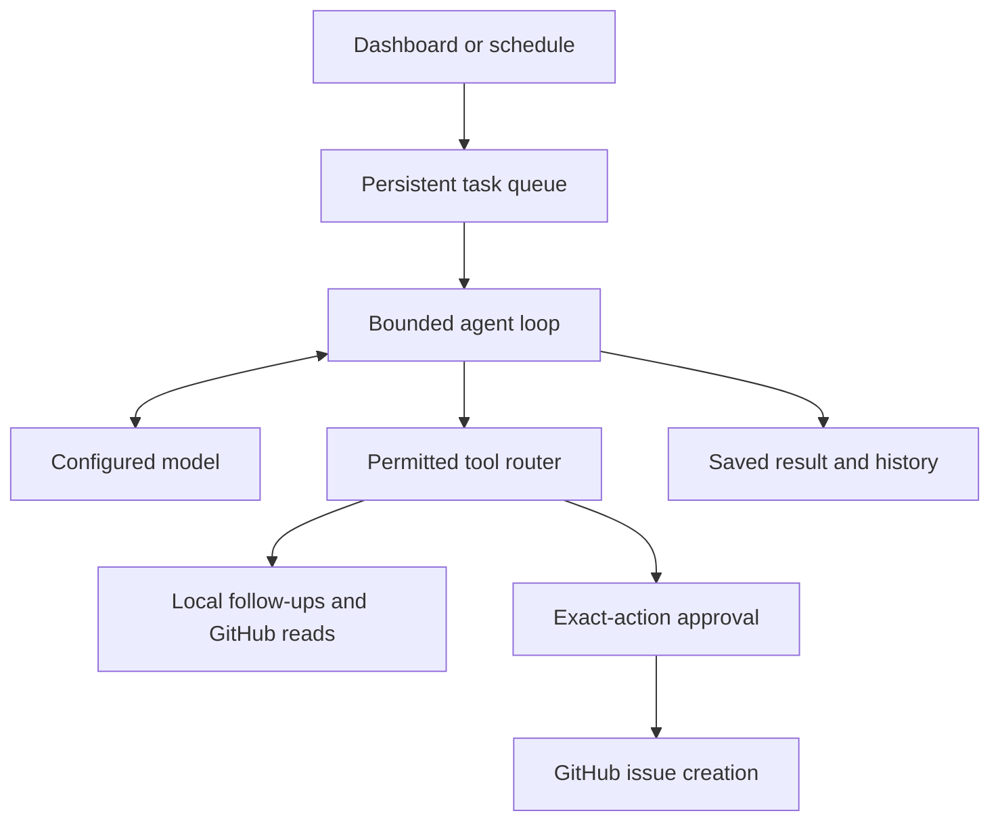

# Work Agents — an automatic task hub

A runnable, single-user work-assistant application added alongside the existing AI workshop examples. Submit a task once: a background worker asks the configured model for the next action, executes a permitted tool, and continues until it saves a report or asks for approval. Daily and weekly schedules create tasks automatically.

The five agents are the Chief of Staff, Meeting Debrief, Weekly Status Writer, Call Prep, and New Hire Setup. This is an independent implementation of that workflow; it does not connect to ChatGPT's internal agents.

## What works

| Agent | Inputs | Outputs and actions |
| --- | --- | --- |
| Chief of Staff | Instructions, local work items, optional repository | Prioritized brief, blockers, saved follow-ups |
| Meeting Debrief | Supplied meeting notes or transcript | Decisions, unresolved questions, local action items |
| Weekly Status Writer | Local tasks, optional repository activity | Source-linked status update and next focus |
| Call Prep | Supplied background, optional repository | Agenda, talking points, questions, context gaps |
| New Hire Setup | Repository README and activity, supplied context | Onboarding checklist and starter follow-ups |

The dashboard includes a task composer, execution history, Markdown downloads, a follow-up checklist, approval review, and schedule pause/resume controls. SQLite persists jobs, checkpoints, schedules, results, and approvals. There is no required cloud service for local operation.

## Try the offline demonstration

Use Python 3.12 or later. From the repository root:

```bash
python -m task_hub --demo
```

Open **http://127.0.0.1:8765**, choose an agent, and use an example or enter a task. Jobs complete automatically and create a labeled demonstration follow-up.

Demo mode uses deterministic templates. It does **not** summarize with an LLM, fetch live GitHub activity, or perform GitHub writes. The UI and each report explicitly identify this mode. Demo records persist just like live records; use a separate `HUB_DATA_DIR` if you want separate histories.

On Windows, install timezone data once before creating schedules or running tests:

```powershell
py -m pip install tzdata
py -m task_hub --demo
```

Linux/macOS normally provide system timezone data. If an IANA timezone is unavailable, install `tzdata` there too. The application otherwise uses the Python standard library and a bundled browser UI; there is no npm build step.

Existing workshop guidance uses `conda activate agents`. That environment can also run this application if its Python version is 3.12+. The implementation checks were run with Python 3.12 in an environment without conda.

## Use your local Ollama model

1. Start your Ollama service and run `ollama list` to see available model names.
2. Copy `task_hub/.env.example` to `task_hub/.env`.
3. Set `MODEL_NAME` to the **exact installed model name** and check `MODEL_URL`.
4. Run from the repository root:

```bash
python -m task_hub --env task_hub/.env
```

Windows PowerShell:

```powershell
Copy-Item task_hub/.env.example task_hub/.env
# Edit task_hub/.env, then:
py -m task_hub --env task_hub/.env
```

The Ollama adapter sends non-streaming JSON requests to `/api/chat`. Choose a model that reliably follows JSON instructions; the runtime rejects malformed actions instead of interpreting them as code. Local model latency and output quality depend on the model and hardware. An unreachable endpoint gets bounded retries and a visible failure.

The compatible adapter works with an OpenAI-compatible chat-completions endpoint supporting JSON responses:

```env
MODEL_PROVIDER=compatible
MODEL_NAME=your-served-model
MODEL_URL=http://127.0.0.1:8000/v1
MODEL_API_KEY=
```

`MODEL_URL` is the base URL; the adapter appends `/chat/completions`. Credentials come only from server configuration, never from task prompts or browser fields. The `.env` loader reads literal `KEY=value` assignments without executing shell code. Already-set environment variables take precedence.

## Connect GitHub to the running application

The ChatGPT GitHub plugin was used to implement this change. Its credentials are **not transferred** into the application. Configure the application's own access on the machine running it:

```env
GITHUB_ALLOWED_REPOS=konankikesava/AIAgent
GITHUB_TOKEN=
GITHUB_WRITES_ENABLED=false
```

Public repository reads can work without a token. For private repositories, use a fine-grained token restricted to the selected repositories with metadata and contents read permission plus issues read permission. Configure `GITHUB_ALLOWED_REPOS` as a comma-separated list. A task cannot access a repository outside this allowlist.

The snapshot reads metadata, a bounded README, up to 20 commits from the past seven days, and up to 20 recently updated open issues, excluding pull requests. Reports must disclose that this is sampled activity. It is **not** a complete release or closed-issue audit.

To allow issue proposals, add issues write permission and set:

```env
GITHUB_WRITES_ENABLED=true
```

Ask the agent explicitly to propose an issue. The task pauses at **Needs review** and shows the exact repository, title, and body. Approving resumes that proposal. Rejecting prevents further proposals of that external action within the same run. Each posted issue gets an audit comment with its approval ID.

An interrupted or failed GitHub write is marked **uncertain** and is never retried automatically. Reconcile the issue in GitHub before creating another task. This avoids claiming exactly-once network delivery when GitHub does not supply an idempotency key for issue creation.

## Schedule automatic work

In **New task**, enable **Repeat this task automatically**. Choose daily or weekly cadence, local time, and an IANA timezone. The default timezone is **Asia/Kolkata**. The first run is the next future slot.

- The service must remain online. Closing a browser tab does not stop workers; stopping the Python process does.
- A restart catches up once for a missed schedule, instead of queuing every missed occurrence.
- An active or approval-blocked scheduled run prevents overlapping runs for that schedule. A skipped slot advances to the next occurrence.
- Pause stops future scheduling; it does not cancel an already-created run.
- Nonexistent daylight-saving times are skipped; ambiguous times fire once at the first occurrence.

For an always-running setup, use Docker Compose or run the process under your machine's service manager.

## Docker

From `task_hub/`, copy and configure `.env`, including a long random `HUB_AUTH_TOKEN`. Generate a token locally, for example with `python -c "import secrets; print(secrets.token_urlsafe(32))"`, and put it in `.env`. Do not commit it.

```bash
cd task_hub
docker compose up --build -d
docker compose logs -f
```

Open **http://127.0.0.1:8765** and enter the hub access token. Compose keeps the service running and stores SQLite in the `hub-data` volume. `docker compose down` preserves that volume; `down -v` deletes it.

Docker uses `DOCKER_MODEL_URL`, defaulting to `http://host.docker.internal:11434`, so the service can reach a model running on its host. Set a reachable URL for your environment. On Linux, an Ollama service bound only to host loopback may require a different network arrangement or a model endpoint reachable by the container. Keep model-service access restricted when changing its bind address. For compatible mode, include `/v1` in `DOCKER_MODEL_URL` if required.

The container uses a non-root user, a read-only application filesystem, resource limits, and a writable data volume. It does not mount the host Docker socket.

## Execution and permission boundaries



Server-enforced tools are `list_work_items`, `add_work_item`, `github_snapshot`, and optionally `github_create_issue`. Tool names, argument schemas, repository scope, step budgets, and approval state are validated in code. The model receives untrusted-source instructions, but prompts are not the authorization boundary.

There is no arbitrary shell, Python execution, SQL execution, or general URL-fetching tool. These work assistants do not need an untrusted-code execution sandbox. Adding a Code/Test/DevOps agent requires a separate isolated execution worker and a different tool policy.

Network binding requires a hub access token of at least 24 characters; the default binds only to loopback. The API rejects cross-origin mutations and unexpected Host headers. Add an explicitly trusted hostname to `HUB_ALLOWED_HOSTS` when using a reverse proxy. For remote access, provide HTTPS at that proxy and keep the service private. This is a single-user service, not a multi-tenant identity platform.

Tasks, transcripts, model history, and results are stored locally in SQLite. The selected model endpoint receives task context and tool results. Use a local endpoint when that data must stay on the machine. Database records are not encrypted by the app; use appropriate disk protection and backups. Only summarized execution events are exposed as the history, while checkpoints retain model conversation state for recovery.

## API

All mutation requests use `Content-Type: application/json`. When configured, supply `Authorization: Bearer <HUB_AUTH_TOKEN>`.

| Method | Route | Purpose |
| --- | --- | --- |
| GET | `/api/health` | Service health |
| GET | `/api/state` | Agents, jobs, follow-ups, schedules, pending approvals |
| POST | `/api/runs` | Queue a task with `agent_id`, `title`, `instruction`, optional `context` |
| GET | `/api/runs/{id}` | Result, events, proposals, and status |
| GET | `/api/runs/{id}/result` | Download a completed Markdown report |
| POST | `/api/runs/{id}/cancel` | Cancel a queued, running, or approval-blocked task |
| POST | `/api/runs/{id}/retry` | Create a fresh attempt of a failed or cancelled task |
| POST | `/api/work-items` | Add a local follow-up |
| POST | `/api/work-items/{id}` | Change status to `open` or `done` |
| POST | `/api/schedules` | Save a task and a daily/weekly schedule specification |
| POST | `/api/schedules/{id}` | Set `enabled` to a boolean |
| POST | `/api/approvals/{id}` | Decide the exact proposal with `approved: true/false` |

Read/model failures retry at most three worker attempts with backoff. Lease expiry recovers interrupted read work. Local follow-up writes are deduplicated by run and step. Cancellation prevents later worker completion from overwriting the cancelled state; an already in-flight external HTTP request cannot be recalled.

## Verification

From the repository root:

```bash
python -m unittest discover -s task_hub/tests -v
node --check task_hub/static/app.js
```

The tests cover queue concurrency, restart recovery, local-write replay, all five demo agents, approval/resume/rejection, uncertain write outcomes, bounded retries, cancellation, HTTP access controls, request and response validation, and scheduling across timezones and daylight-saving changes. Model protocol tests use fixtures rather than paid/live model calls. The GitHub Actions workflow runs the suite on Python 3.12 and 3.14 on Linux and on Python 3.14 on Windows, and builds and smoke-tests the Docker image on Linux.

Implementation verification also exercised task completion, report downloads, weekly schedule creation, pause/resume, follow-up completion, HTML escaping, and desktop/mobile layout in a headless browser with no script errors. An unauthenticated live read of the public target repository verified the GitHub snapshot adapter. No live model calls or GitHub issue writes were made during those checks.

Live LLM quality and live GitHub mutations require your configured endpoint and credentials. Gmail, Calendar, Jira, Slack, browser automation, retrieval memory, and sandboxed code editing are not wired into this edition. Meeting notes are supplied in the task composer. The tool router is the extension point for adding a separately authorized adapter.

Protocol references: [Ollama chat API](https://docs.ollama.com/api/chat), [GitHub issues REST API](https://docs.github.com/en/rest/issues/issues), [Python timezone data](https://docs.python.org/3/library/zoneinfo.html).
